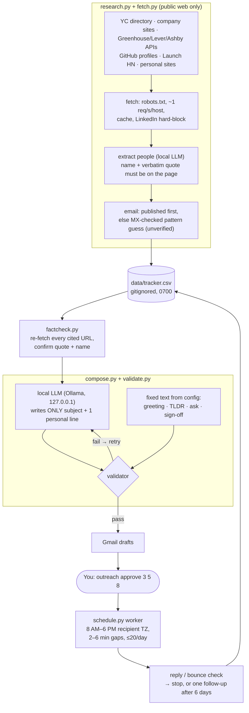

# Outreach

[](https://github.com/Rudra-C-Patel/outreach/actions/workflows/ci.yml)


**An approval-gated cold-email pipeline for an internship search. It finds real people from public sources, fact-checks every claim against the cited page, lets a local LLM write exactly one sentence per email, validates it, and sends from Gmail only after you approve each message.**

## Why it exists

Cold email works when it's specific and honest, and it's ruinous when it's wrong: an invented detail, a misspelled company, or 50 identical emails at 3 AM. I wanted the leverage of automation for the tedious parts (finding people, finding addresses, scheduling sends) and none of the risk for the parts that matter. So the model is boxed into one sentence, every fact has a citation, and nothing leaves without my explicit `approve`.

## Architecture



## Features

- **Public-source research.** Sources include the YC directory, company sites, Greenhouse/Lever/Ashby public job APIs, GitHub profiles, Launch HN, personal sites and URLs you pass. `--yc-interns N` finds YC companies currently posting intern roles.
- **Email discovery with honesty labels.** It looks for published addresses first: page text, `mailto:`, URL-encoded and `[at]/(dot)` forms, GitHub profiles. A pattern guess is used only when the domain has MX records, and it's marked **unverified**. Unverified addresses are capped at 20% of every research batch and every daily batch.
- **Fact-check gate.** Every row has a source URL and a verbatim quote. `factcheck` re-fetches each one and must pass before anything is drafted.
- **Model in a box.** The LLM writes only the subject and one personal line. Greeting, TLDR bullets, the ask and the sign-off are fixed strings in `config.py`, so the model can't rewrite your credentials.
- **Validator.** It rejects bodies over 120 words, hype words, fake familiarity, any `!`, numbers that aren't in the TLDR, a modified TLDR, proper nouns not found in the source, first-person claims beyond "I saw/read/came across", subjects that don't name the company, and clickbait.
- **Scheduler.** Approved emails go out 2–6 minutes apart at random, only between 8 AM and 6 PM in the recipient's time zone, capped at 20 per day. All three guards are re-checked right before each send.
- **Sequence logic.** A reply or bounce stops the sequence. After 6 days of silence, exactly **one** short follow-up is drafted for approval, never a second.
- **Gmail-native review.** Edits you make to a draft in Gmail are what gets sent. Deleting the draft in Gmail cancels it.

## Privacy and safety design

| Rule | Enforced by |
|---|---|
| **Nothing sends without approval** | Only `approve <ids>` queues a draft. The worker sends only approved rows and re-checks the window, gap and daily cap before every send. |
| **LinkedIn is never automated** | `fetch.is_blocked` rejects `linkedin.com`, `lnkd.in` and `licdn.com` (and subdomains). An httpx request hook re-checks **every redirect hop before it's sent**, so a redirect chain can't reach LinkedIn either. LinkedIn URLs can't be used as `add` sources. |
| **One sending identity** | Before every draft and send, `gmail.assert_sender` confirms the authenticated account is `OUTREACH_SENDER`. If `auth` logs in as anyone else, the token is deleted on the spot. With no sender configured, every Gmail action refuses to run. |
| **Local LLM** | Extraction and the personal line come from Ollama on `127.0.0.1`. No cloud LLM API is called. |
| **No invented people or facts** | Extracted people need their name and a verbatim quote on the fetched page, and the validator rejects proper nouns that aren't in the source. |
| **Polite crawling** | robots.txt is respected, requests are rate-limited to about 1/s per host and cached, and the User-Agent identifies the tool. |
| **Secrets stay local** | OAuth client, token (written `0600`, never printed), tracker, drafts, cache and send log all live in `data/` (`0700`, gitignored). Personal settings live in a gitignored `outreach.env`. |

## Setup

```bash
git clone https://github.com/Rudra-C-Patel/outreach ~/outreach && cd ~/outreach
uv venv --python 3.11 .venv && uv pip install --python .venv/bin/python -e '.[dev]'
cp outreach.env.example outreach.env        # your sender address, name, resume path
alias outreach=~/outreach/.venv/bin/outreach
ollama serve &                              # local model on 127.0.0.1:11434
```

**Gmail OAuth** (free, no billing account):

1. In Google Cloud, create a project and enable the **Gmail API**.
2. Under Google Auth Platform, set the audience to **External**, and add your own address as a **test user**.
3. Add the scopes `gmail.compose`, `gmail.send` and `gmail.readonly`.
4. Create a **Desktop app** client, download the JSON, and save it as `data/credentials.json`.
5. Run `outreach auth` and sign in as `OUTREACH_SENDER`.

In Testing mode, Google expires refresh tokens after 7 days, and `outreach` tells you when to re-run `auth`. Optionally, set `GITHUB_TOKEN` (no scopes) to raise GitHub's anonymous rate limit during research.

## Usage

```bash
outreach research "Acme=acme.dev" "Initech=initech.io"   # or @companies.txt
outreach research --yc-interns 5
outreach add --name ... --company ... --role ... --email ... --verified|--unverified \
             --source URL --quote "verbatim text" [--tz America/New_York] [--ask startup]
outreach factcheck              # re-fetch every cited URL
outreach today [--local]        # check replies, draft follow-ups, then ≤20 Gmail drafts
outreach approve 3 5 8          # or: approve all  (--background to detach)
outreach status                 # pipeline + reply rate
outreach test-send <your-own-address>   # proves the send path to your own inbox
```

Status flow: `new → drafted → approved (queued) → sent → replied / bounced / follow-up → closed` (or `skipped`).

## Tests

```bash
.venv/bin/pytest -q
```

**36 pytest tests** cover the validator (7 distinct bad personal lines, length, subject and ask rules), the scheduler (send window, gaps, daily cap), the unverified-address cap, the LinkedIn block (including a redirect hop into LinkedIn being refused before it's sent), published and obfuscated email parsing, pattern inference, local config loading and the sender-identity guard. They also run an **end-to-end flow against a fake Gmail**: approval gating, a draft deleted in Gmail cancelling the send, reply detection and the one-follow-up rule. No test touches the network or a real account. CI runs them on Python 3.11, 3.12 and 3.13.

## Limitations

- **Pattern-guessed emails can bounce.** MX records prove the domain accepts mail, not that the mailbox exists. That's why guesses are labelled and capped at 20%.
- **Fact-checking is string matching.** It confirms the quote and name are on the page, not that the page is current or that the person still holds the role.
- **JS-heavy sites are invisible.** The fetcher reads server-rendered HTML only.
- **Single user, single Gmail account**, running on one machine. The worker is a local process, so sends pause if the laptop sleeps.
- **The TLDR and asks are mine.** They're fixed strings in `config.py`; edit them for your own search.

## What I learned

- **Constrain the model's job, then validate the small part it owns.** Letting the model write only one sentence, with the rest fixed text, turned an unreliable email writer into something I could check mechanically.
- **Every claim needs a pointer back to evidence.** Storing a source URL and a verbatim quote per person made fact-checking automatic, and it made "no invented people" a property of the data rather than a hope.
- **Human approval belongs at the irreversible step.** Research and drafting are cheap to redo, and a sent email isn't. So the approval gate sits right before sending, and the scheduler's guards are re-checked at send time, not just when the email is queued.
- **Test the dangerous paths with fakes.** A fake Gmail let me test "deleted draft means no send" and "reply stops the sequence" end to end without ever risking a real email.

## License

[MIT](LICENSE)
